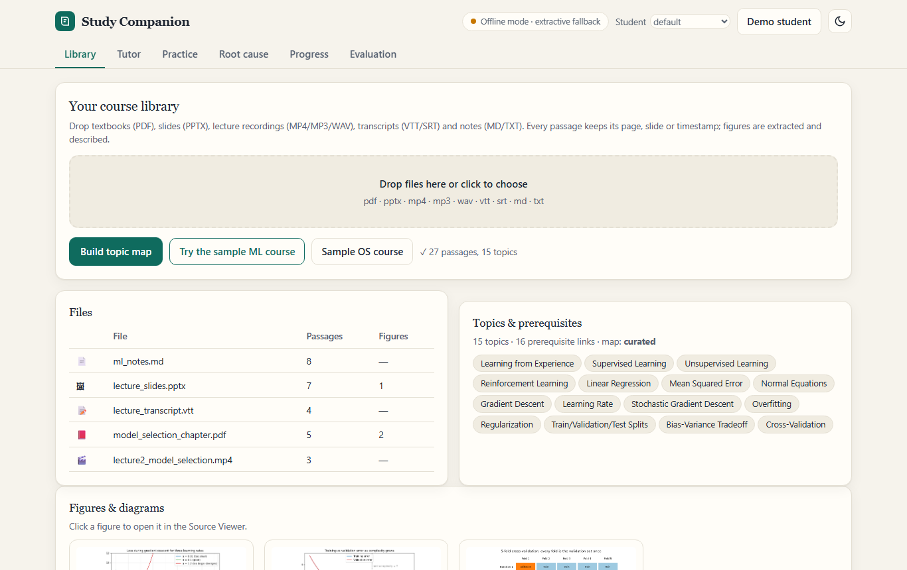
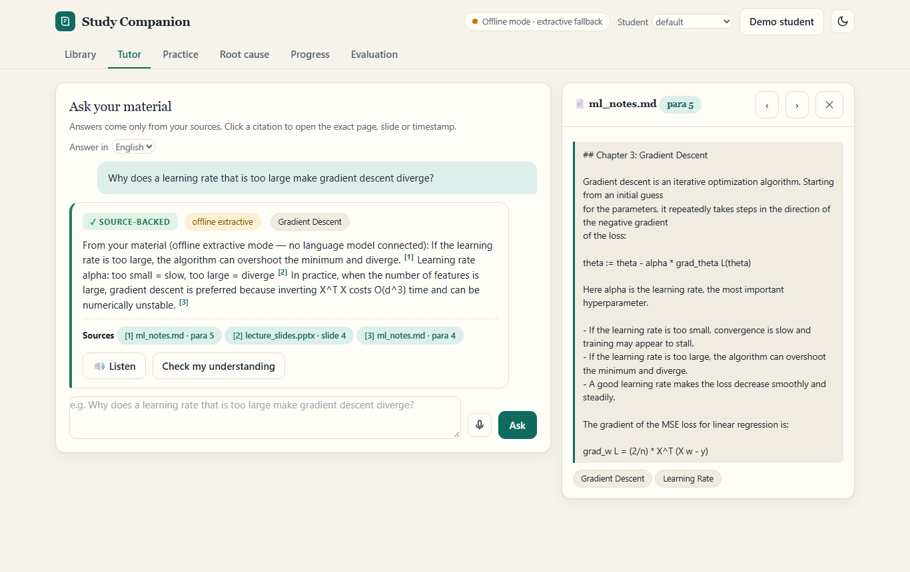
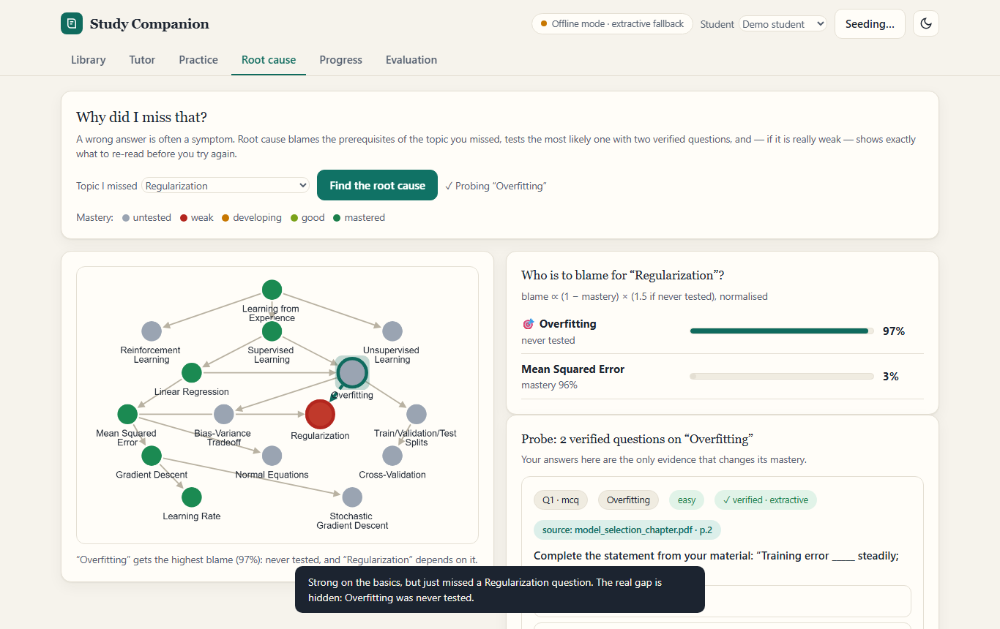
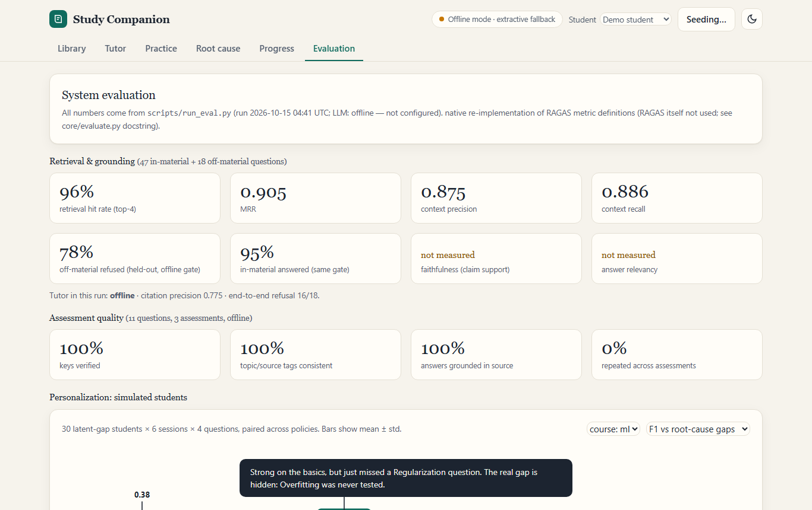

# Study Companion

**A source-grounded study tutor that doesn't just tell you what you got wrong — it finds why.**
Multimodal AI Hackathon 2026 · Track D: Personalized Tutoring & Adaptive Learning

Study Companion turns lecture videos, textbooks and slide decks into one source-linked knowledge base. The tutor answers only from that material, with citations that open the exact PDF page, slide or video timestamp; it declines what the material does not cover; it writes verified quizzes; it models what each student knows — and when a student misses a topic, **RootCause** checks the prerequisites to find the real gap and sends them to the exact passages to re-read.

| Library | Tutor + Source Viewer |
|---|---|
|  |  |
| **Root cause** | **Evaluation** |
|  |  |

_Screenshots were taken in offline mode (no language model connected), which the UI states in its header._

## Quick start

```bash
pip install -r requirements.txt            # add requirements-dev.txt for tests, demo recording, sample generation
cp config.example.env .env                 # then put your key in .env (optional: runs offline without one)
python server.py                           # http://127.0.0.1:7861
```
Windows: `scripts\start.ps1`. Docker: `docker compose up --build` (reads `.env`; keys never enter the image).

In the UI: **Library → "Try the sample ML course"** (loads five files including a PDF with figures and a narrated lecture video), ask a question in **Tutor**, then press **Demo student** to walk through the RootCause story.

### Models
Any OpenAI-compatible endpoint (OpenAI, OpenRouter, a local server). Optional `VERIFY_MODEL` (cross-model check of quiz keys) and `VISION_MODEL` (figure descriptions). Audio/video are transcribed locally with faster-whisper. **No model, no key, or no credits?** Everything still works in a clearly labelled offline mode: extractive answers, fill-in-the-blank questions, curated/heuristic topic maps. See `config.example.env`.

## What is implemented (Track D requirement map)

| Requirement | Implementation |
|---|---|
| 1a–d Multimodal knowledge base | PDF, PPTX, MD/TXT, VTT/SRT, **MP4/MP3/WAV via Whisper**; **figures extracted** from PDF/PPTX and described by a vision model; topic map with prerequisites; every unit keeps file + page / slide / timestamp |
| 2a–b Source grounding | cited answers, **Source Viewer** (PDF page image, slide preview, figure, video seek), calibrated refusal gate, flagged outside-knowledge on request |
| 3a–c Adaptive assessment | tagged MCQ / short / numerical questions, independent (optionally cross-model) verification, per-student novelty, cited feedback, post-assessment report with likely misconceptions |
| 4a–b Learner model | BKT per student and topic, diagnostic quiz + intake for new students, evidence-only updates |
| 5a–c System evaluation | native RAGAS-definition metrics, a labelled test set with ground-truth source locations, simulated latent-gap students (3 policies, paired, CIs) — [docs/EVALUATION.md](docs/EVALUATION.md) |
| 6a–e Optional | prerequisite flow map, flashcards and spoken briefs for weak topics, forgetting-curve schedule, Hindi answers + voice in/out (browser speech) |
| **Differentiator** | **RootCause** — prerequisite blame → verified probe → repair path → re-test |

## Honest status
All numbers in the docs come from `scripts/run_eval.py` → `eval_report.json`. Metrics that need a language model (faithfulness, answer relevancy, LLM-written question quality, figure descriptions) are reported as *not measured* when the run had no working model. The simulated-student results are paired and include confidence intervals; RootCause clearly improves root-cause F1 over plain weakest-first tracking but does not win every metric — see the evaluation doc, including its limitations.

## Repository layout
```
server.py            FastAPI app (REST + static UI)        static/index.html   single-file UI (Tailwind CDN, vanilla JS, Cytoscape)
core/                ingest, vision, retrieve, tutor, quiz, learner, rootcause, recommend, report, revision, evaluate, simulate, offline, preview, store, llm
data/sample_courses/ ml (notes, slides w/ chart, VTT, PDF w/ figures, narrated mp4)   os (second course)
tests/               pytest suite + testset.json            scripts/            eval, sample generation, UI smoke test, demo recorder
docs/                ARCHITECTURE, EVALUATION, DEMO_SCRIPT, MERGE_NOTES, UNDERSTANDING, BASELINE, HANDOFF
```

## Commands
```bash
python -m pytest tests                       # unit + API + multimodal tests (offline, ~15 s)
python scripts/run_eval.py [--write-gate]    # evaluation → eval_report.json + docs/EVALUATION.md
python scripts/make_devpost.py               # DEVPOST_TEXT.md from eval_report.json
python scripts/make_sample.py                # regenerate the sample course material
python scripts/ui_smoke.py                   # drive every screen in a browser (server must be running)
python scripts/make_demo.py [--offline]      # record demo/final.mp4 (never uploads anything)
```

## Credits
- Built on top of an open-source study-companion repository (retrieval/tutor/quiz/BKT skeleton). **Original author: _add name/link here_** — the original README did not name them.
- Ideas (not code) from the **LearnFlow AI** project: next-best-action reasons, misconception tracking, source-viewer and knowledge-map UX, Docker packaging, and the Operating Systems sample notes. What we took and what we rejected is in [docs/MERGE_NOTES.md](docs/MERGE_NOTES.md).
- Libraries: FastAPI, scikit-learn, PyMuPDF, python-pptx, faster-whisper, Pillow, Cytoscape.js, Tailwind CSS, Playwright, edge-tts.
